<picture>
  <source media="(prefers-color-scheme: dark)" srcset="assets/header-dark.svg">
  
</picture>

 

<picture>
  <source media="(prefers-color-scheme: dark)" srcset="assets/intro-dark.svg">
  
</picture>

  <a href="https://bugra-berat-kok-portfolio.vercel.app/"><picture><source media="(prefers-color-scheme: dark)" srcset="assets/button-portfolio-dark.svg"></picture></a>
  &nbsp;
  <a href="https://www.linkedin.com/in/bugraberatkok/"><picture><source media="(prefers-color-scheme: dark)" srcset="assets/button-linkedin-dark.svg"></picture></a>
  &nbsp;
  <a href="mailto:kokbugraberat@gmail.com"><picture><source media="(prefers-color-scheme: dark)" srcset="assets/button-email-dark.svg"></picture></a>

 

<picture>
  <source media="(prefers-color-scheme: dark)" srcset="assets/experience-dark.svg">
  
</picture>

 

<picture>
  <source media="(prefers-color-scheme: dark)" srcset="assets/education-dark.svg">
  
</picture>

